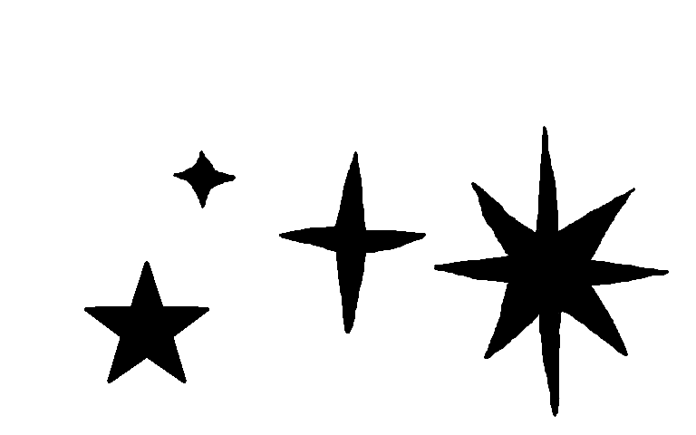
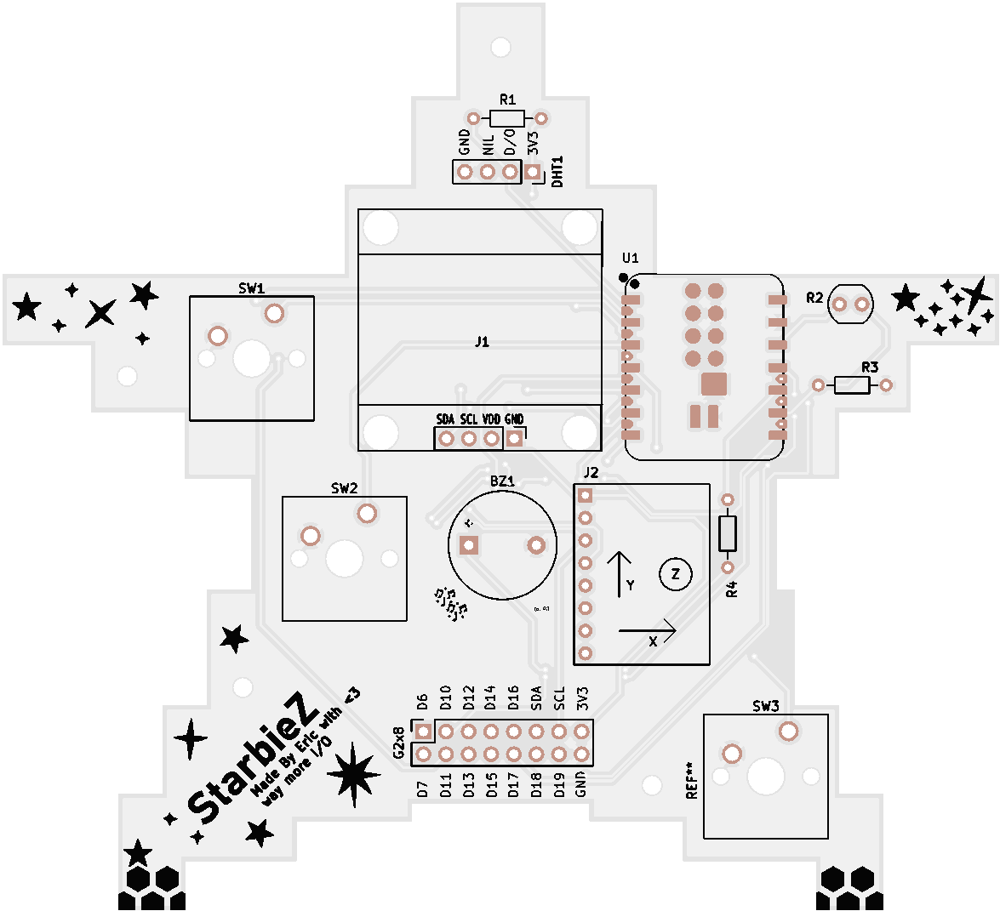
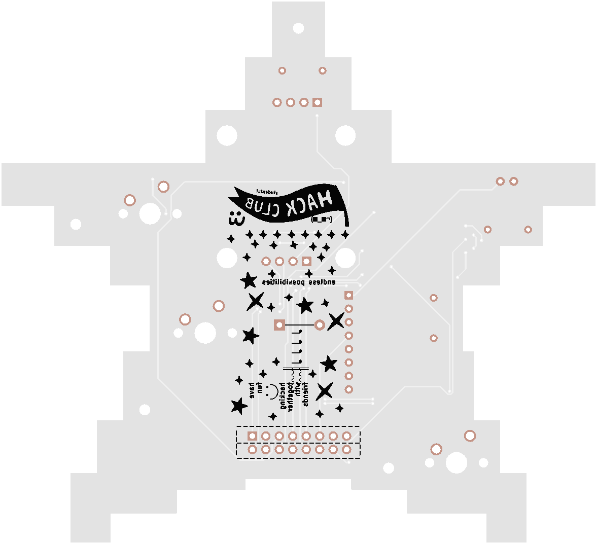

# StarbieZ (star-beez)

Starbiez is a redo of the [Starbie](https://github.com/SharKingStudios/Starbie), and boy it packs *serious* power!

You're now getting your own extendible Tamagotchi that can run MANY things, basically sort of like a *Flipper Zero Nano* but without the pentesting tools! (don't go hacking things around town with this... :C)

## What it does

the ESP32-S3 Plus is where I'd start the shift from MCU to CPU, and it's the main driver for this project. With 16 MB of flash and 8 MB of RAM, it's way more than all the classic Tamagotchis that had **1 KB of RAM and ROM**! this Starbie is equipped with greater environmental awareness, audio and just *one more* button that adds so many more possibilities for what can be done with this project.

the environment can be currently measured by these sensors:

* a light dependent resistor on the right front face of the board
* a DHT11 humidity sensor on the top front face of the board
* AND a 6 pin IMU called the MPU6050 at the bottom right of the board!

the outputs on this device are *pretty simple*:
* 128x64 SSD1306 OLED screen
* buzzer/piezo

you provide input to this project by literally just clicking the cherry MX keyboard switches... and the circuitpython software being packaged for this project is considerably extendable being based off of the C++/.INO software. (yes, I'm rewriting/have rewritten it to make it easier for extensions, welcome beginners!)

## Bill of materials

| Part | What it's for | Qty | Unit | Total | Vendor |
| --- | --- | --- | --- | --- | --- |
| [ESP32-S3 Plus](https://www.pakronics.com.au/products/seeed-studio-xiao-esp32s3-plus-20-gpios-2-4ghz-wifi-ble-5-0-8mb-psram-16mb-flash-esp32-s3-dual-core-battery-charge-supported-ss102010671) | Main loop, more GPIO | 1 | $11.50 | $11.50 | [Pakronics](https://www.pakronics.com.au/products/seeed-studio-xiao-esp32s3-plus-20-gpios-2-4ghz-wifi-ble-5-0-8mb-psram-16mb-flash-esp32-s3-dual-core-battery-charge-supported-ss102010671) |
| [Gateron Milky Pro Switches (10pcs)](https://www.aliexpress.com/item/1005006425450443.html) | Switches and satisfying clicks | 1 | $1.06 | $1.06 | [AliExpress](https://www.aliexpress.com/item/1005006425450443.html) |
| [White 128x64 OLED display](https://www.aliexpress.com/item/1005004355547926.html) | The face of Starbiez | 1 | $2.85 | $2.85 | [AliExpress](https://www.aliexpress.com/item/1005004355547926.html) |
| [DHT22 Chip](https://core-electronics.com.au/dht22-temperature-and-relative-humidity-sensor-module.html) | For improved humidity sensing | 1 | $2.38 | $2.38 | [Core Electronics](https://core-electronics.com.au/dht22-temperature-and-relative-humidity-sensor-module.html) |
| [MPU6050 3-axis IMU](https://www.aliexpress.com/item/1005007989748804.html) | For shaking Starbiez | 1 | $2.92 | $2.92 | [Core Electronics](https://www.aliexpress.com/item/1005007989748804.html) |
| [600 Pack of 1/4 Watt 1% Resistors (30 values, 20 of each)](https://core-electronics.com.au/600-pack-of-1-4-watt-1-resistors-30-values-20-of-each.html) | For resistance in the circuit | 1 | $1.87 | $1.87 | [Core Electronics](https://core-electronics.com.au/600-pack-of-1-4-watt-1-resistors-30-values-20-of-each.html) |
| [Light dependent resistor](https://core-electronics.com.au/light-dependent-resistor-ldr.html) | For helping Starbiez sleep | 1 | $0.22 | $0.22 | [Core Electronics](https://core-electronics.com.au/light-dependent-resistor-ldr.html) |
| [Generic buzzer (⌀11 x 9)](https://core-electronics.com.au/piezo-buzzer.html) | For buzzing through menus (sound interactivity and accessibility) | 1 | $0.22 | $0.22 | [Core Electronics](https://core-electronics.com.au/piezo-buzzer.html) |
| [0.100" (2.54 mm) Female Header: 2x8-Pin, Straight](https://core-electronics.com.au/0-100-2-54-mm-female-header-2x8-pin-straight.html) | For GPIO connectivity (if anyone wanted to use this as a devboard) | 1 | $2.16 | $2.16 | [Core Electronics](https://core-electronics.com.au/0-100-2-54-mm-female-header-2x8-pin-straight.html) |
| [Mint Green MA Keycaps for MX Compatible Switches (5pcs)](https://core-electronics.com.au/mint-green-ma-keycaps-for-mx-compatible-switches-5-pack.html) | For topping off the Gateron Milky Pro Switches | 1 | $6.00 | $6.00 | [Core Electronics](https://core-electronics.com.au/mint-green-ma-keycaps-for-mx-compatible-switches-5-pack.html) |
| [JLCPCB Fab](https://jlcpcb.com) | Starbiez PCB | 1 | $11.95 | $11.95 | [JLCPCB](https://jlcpcb.com) |
| **Parts subtotal** | — | — | — | **$43.13** | — |
| **Tax & shipping** | — | — | — | **$27.33** | — |
| **Total** | — | — | — | **$70.46** | — |

## The process of building
### Day 1!

I spent the whole day, and I quite probably went past 4 hours (the actual making time of my board) to include the things that would make it my own...

You can see the **timestamps in the screenshot names**, for journal purposes I didn't replace them with a generic name throughout my processes!

How to interpret them:

* Example: `Screenshot 2026-10-06 064450.png`
* `2026-`: The year
* `10-`: The month
* `06`: The day
* `064450`:
    * `06`: The hour of the day (in AEST/AEDT, since I'm working on it in Australia/Sydney!)
    * `44`: The minute of the hour `06`
    * `50`: The seconds the screenshot was taken at

Hope this helps!

1. I created the project and crafted the schematic from the [tutorial](https://github.com/SharKingStudios/Starbie)

    

2. I laid out my PCB, creating the star `Edge.Cuts` from a reference image I found on Google first

    
    

    and then the satisfying ground layer by the B button...
    

    Those steps took about 4 hours and 5 minutes, timed by Google stopwatch (thanks search engine monopoly... never mind)

3. One of my first modifications was with changing the MCU from an ESP32-C3 to an ESP32-S3. My first strongest candidate.

    

    This swap didn't take very long... They're very structurally similar. I made sure to check Seeed's official guides though, just in case I got the pinouts wrong.

4. I included a second sensor, the LDR03 (light-dependent resistor is what LDR stands for) and I made sure to include a fixed resistance of 10kΩ, though this would change later down the track in my realisation an LDR03 is VERY hard to source in the real world today...!

    

    Here's where I put it, on the right wing of the star :)

    

    

5. A lot of organisation, and another output was added! A buzzer or a piezo was inspired by the Sprig's design when I made my Columns game for them (still waiting for approval), and I feel this Tamagotchi would do *really* well with a bit of tunes.

    
    

    I put in a little resistor to prevent any surge back to the tiny ESP... yeah it's pretty small.

    

6. I found a honeycomb SVG on Flaticon and I decided to use it for the two bottom corners of the board to add some more decoration!

    

    This was also the time I figured out how to get the 3D models into the footprints, I spent a long time trying to figure out how to get into the footprint editor...

7. Realizing there was not enough clearance for poor Switch 3 around J2, I had to make a few changes. And these changes would be for the better, it's now a dev board... :P It's when I made the switch to the ESP32-S3 Plus to get more GPIO. This is when my board started to look a lot more like trace spaghetti, but it's okay... (I am guessing)

    

    

    

    Now there's odd-even 2x8 GPIO female pins on the board, featuring these that go to the ESP32-S3 Plus! Go from right to left if you flip the Starbiez on it's right side:

    | Pin | GPIO |
    |-----|------|
    | 1 (right) | D6 |
    | 2 (left) | D7 |
    | 3 (right) | D10 |
    | 4 (left) | D11 |
    | 5 (right) | D12 |
    | 6 (left) | D13 |
    | 7 (right) | D14 |
    | 8 (left) | D15 |
    | 9 (right) | D16 |
    | 10 (left) | D17 |
    | 11 (right) | SDA (for I2C!) |
    | 12 (left) | D18 |
    | 13 (right) | SCL (for I2C!) |
    | 14 (left) | D19 |
    | 15 (right) | 3V3 output, make sure not to draw too much! |
    | 16 (left) | board GND |

    

    
Pin reference image for you nerds...

    > ## Front
    >
    > 
    >
    > ## Back
    > 

    

    

    (*sparkles*!!) The sparkles I got from Claude, I asked it to make a flat monochrome white sparkle SVG graphic I could use... I plastered it onto the board on all the corners. (***THIS GRAPHIC IS NOW OUTSIDE OF THE FINAL REVISION DUE TO HALF LIFE REQUIREMENTS***)

8. Around this time, I was searching for good parts to use on AliExpress, but I found that shipping from China is a *little* bit too expensive for the grant I'm receiving. I then got a little distracted, still worrying myself about whether the light-dependent resistor I've wired up would be correct. More research got me to change it to a generic one, so here's the LDR part I recommend if anyone tries to build this project:

    | Specification | Value |
    |---------------|-------|
    | dark resistance (pitch black, 0 lux) | ~10MΩ |
    | light resistance (10 lux) | 8kΩ to 20kΩ |
    | max dissipation | 100mW
    | form factor | THT ~5mm |
    | ideally... | the GL5528 |

    I also switched the fixed resistance to 100kΩ so the ESP32-S3 Plus receives a more controlled value than in **0.03 V** or completely uncharted territory...

    

    

this took me the ENTIRETY of yesterday to build it and some of today to refine it, in retrospect I got up really early some days :| it took me about 1 hour and 22 minutes to write this writeup, according to Hackatime. I hope every viewer likes this project of mine!

### Day 2

I have swapped out the Claude star assets for my own as requested from Hack Club Half Life. It took about 45 minutes to draw the star assets in MS Paint.

I then converted these black paths into an SVG using Inkscape...

And afterwards, I redone the design of the silkscreen by my two hands. This took about 25 minutes.

I also added mounting holes in four places, as you can see.

### Final board renders (courtesy of JLC)

## Software

I extended/am extending CircuitPython for this project for providing user access to an API, you can view my extensions to CircuitPython [here](https://github.com/JustAnEric/starbiez-circuitpython)! It's recommended to use this instead of normal CircuitPython on your ESP32-S3, as you probably won't have access to much easy modifications.

## Ending README

hopefully Hack Club likes this little project of mine, so I can keep developing it more and more... I'm definitely pushing boundaries here with what can be done, but...